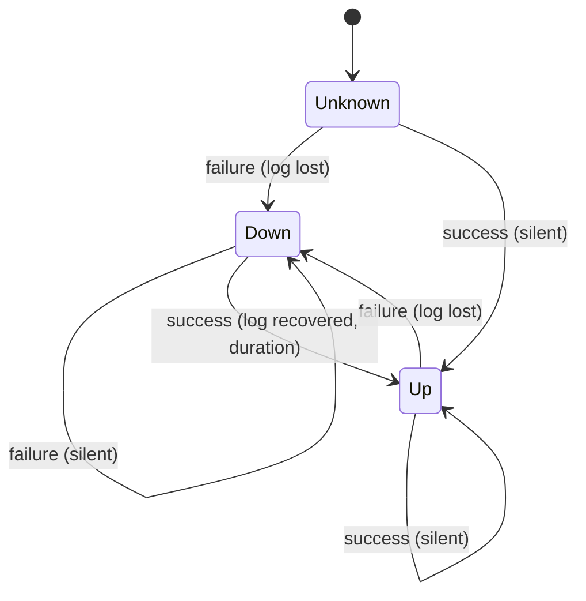

# REQ-016: Log connectivity state transitions for the task source and aw-server

- **Status:** Documented, not implemented
- **Added:** 2026-11-20
- **Owner:** maintainer

## Rationale

The daemon depends on two links: the task source (task-rest for `provider = "http"`, the `task` command for `provider = "cli"`) and the ActivityWatch server. Today a failed poll logs an error on every poll (about every 5 s), and a failed heartbeat logs on every poll too. Nothing marks the recovery, and nothing gives the length of an outage. A laptop suspend that breaks one of these links is hard to diagnose from the log, because the outage start, end and length have to be reconstructed from repeated lines.

The owner needs one line when a link goes down and one line when it comes back, with the outage length.

## Design

### States

Each link has its own state, starting as `Unknown`:

- `Unknown`: no attempt has succeeded or failed yet (daemon start).
- `Up`: the last attempt succeeded.
- `Down`: the last attempt failed. The state records when the outage started and how many polls failed.

### Transitions and log lines

| From | Event | Log line |
|------|-------|----------|
| `Unknown` or `Up` | failure | ERROR, once: `task provider '<name>' failing: <error>; reusing last known task` for the task source, or `ActivityWatch server unreachable: <error>; heartbeats are not delivered until it returns` for aw-server |
| `Down` | failure | nothing |
| `Down` | success | INFO, once: `task provider '<name>' recovered after <duration> (<n> failed polls)`, or `ActivityWatch server recovered after <duration> (<n> failed polls)` |
| `Unknown` | success | nothing (the first success after start is silent) |
| `Up` | success | nothing |

The per-poll error lines of REQ-007 and REQ-013 (`task provider '<name>' failed, reusing last known task`) are replaced by the transition lines above. The reuse of the last known task does not change.

Durations are formatted as `1h 02m 03s`, `4m 05s` or `12s`.

### Clock

The outage duration uses the wall clock (`chrono::Utc::now()`), not a monotonic clock. A monotonic clock may not advance during system suspend, depending on the OS, and suspend is the case this logging is meant to diagnose. The wall clock includes the time asleep. A manual clock change during an outage can skew the reported duration.

### Limits

- **Every provider error counts as failing,** including `InvalidResponse`. The error text in the line says which kind it was.
- **aw-server state changes only when a heartbeat is attempted.** While idle with `no_task_title` unset (REQ-015), no heartbeat is sent, so an aw-server outage is noticed only at the next heartbeat.
- **HTTP status codes from aw-server are not checked.** The pinned `aw-client-rust` ignores them, so only transport failures (connection refused, timeout, DNS) mark aw-server as `Down`.
- **One line per transition.** Line breaks in the error text (the `task` command's stderr can have them) are replaced with spaces.
- **Only the transition is logged.** If the error text changes during one outage (for example connection refused, then timeout), the change is not logged.
- **The startup bucket creation loop** (`ensure_bucket_with_shutdown_check`, retried every 30 s) keeps its own per-attempt log lines and is not changed.

### Modules

- New `crates/aw-taskwarrior/src/connectivity.rs`: the state machine (`LinkMonitor`, `Transition`), the pure `record_ok` and `record_err` functions that take `now` as a parameter, the message builder `describe`, `format_duration`, and `observe`, which reads the clock and writes the log line.
- `crates/aw-taskwarrior/src/providers.rs`: `resolve_task` takes a `&mut LinkMonitor` and reports to it instead of logging each failure.
- `crates/aw-taskwarrior/src/main.rs`: creates one monitor per link before the poll loop and reports heartbeat results to the aw-server monitor.

See [../modules.md](../modules.md) for the items. No new dependency: `chrono` is already used.

### State diagram

## Acceptance criteria

- [ ] A first failure after an `Up` or `Unknown` state logs one ERROR line naming the link and the error.
- [ ] Repeated failures while `Down` log nothing.
- [ ] The first success after `Down` logs one INFO line with the outage duration and the number of failed polls.
- [ ] A success while `Unknown` or `Up` logs nothing.
- [ ] Both links are reported separately: a task source outage does not change the aw-server state, and the reverse.
- [ ] The per-poll error line from `resolve_task` is gone.
- [ ] The state machine is tested without a real clock (`now` is a parameter), and `format_duration` and `describe` are tested.

## Code references

- Implemented in: (empty until implemented)
